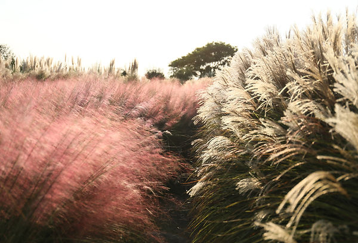
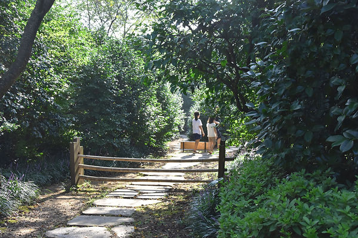
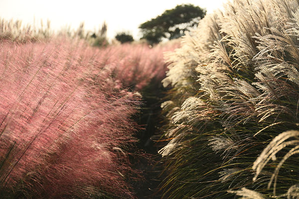

# 카멜리아힐 사진 자료 (1일차 16:00 방문)

## 장소 설명
- 주소: 제주도 서귀포시 안덕면 병악로 166 (공식 홈페이지 기재)
- 전화: 064-759-0088 (공식 홈페이지 기재)
- 공식 홈페이지에는 장소를 소개하는 긴 설명 문장이 없고, "어떤 아름다운 꽃들이 피어있는지 확인해보세요", "카멜리아 힐 지도를 보면서 확인하세요" 같은 안내 문구만 있습니다.
- 운영시간과 입장료는 기존 [카멜리아힐.md](카멜리아힐.md) 참고

## 사진 (공식 홈페이지에서 가져온 3장)
사진은 이 폴더의 "사진" 폴더에 내려받아 저장해 두었습니다. 인터넷이 없어도 보입니다. 원래 인터넷 주소는 사진 아래에 "원본 주소"로 남겼습니다.

### 사진 1

- 원본 주소: https://static.wixstatic.com/media/98e022_730ec7b976f9483895c802e2d1852a8e~mv2.jpg/v1/fill/w_600,h_408,al_c,q_80,usm_0.66_1.00_0.01,enc_avif,quality_auto/CAM_4200%20%EB%B3%B5%EC%82%AC%EB%B3%B8.jpg
- 설명: 공식 홈페이지 "요즘, 카멜리아 힐" 꽃 안내 부분에 실린 사진
- 출처: https://www.camelliahill.co.kr/

### 사진 2

- 원본 주소: https://static.wixstatic.com/media/98e022_dd036d249ecd4fc39564c9f27c094efb~mv2.jpg/v1/fill/w_600,h_400,al_c,q_80,usm_0.66_1.00_0.01,enc_avif,quality_auto/DSC_4667.jpg
- 설명: 공식 홈페이지 "카멜리아 힐 지도" 안내 부분에 실린 사진
- 출처: https://www.camelliahill.co.kr/

### 사진 3

- 원본 주소: https://static.wixstatic.com/media/98e022_0b984bb76339442f8f51917a2aff9ec2~mv2.jpg/v1/fill/w_600,h_400,al_c,q_80,usm_0.66_1.00_0.01,enc_avif,quality_auto/CAM_4201_JPG.jpg
- 설명: 공식 홈페이지 "가을 가을한 카멜리아 힐" 부분에 실린 사진
- 출처: https://www.camelliahill.co.kr/

## 확인 상태와 주의
- 세 사진 주소는 열어 보니 모두 정상으로 응답했습니다.
- 사진 속 모습은 제가 직접 보지 못했습니다. 위 설명은 사진이 실린 홈페이지 부분의 제목을 근거로 적은 것이라, 실제 사진과 다를 수 있습니다.
- 사진 파일은 공식 홈페이지가 쓰는 이미지 저장소(static.wixstatic.com)에서 불러옵니다. 공식 홈페이지 주소가 아니라 홈페이지의 사진 보관 주소입니다.
- 12월 동백 개화 상태는 이 사진으로 알 수 없습니다. 사진 3은 가을 풍경입니다.
