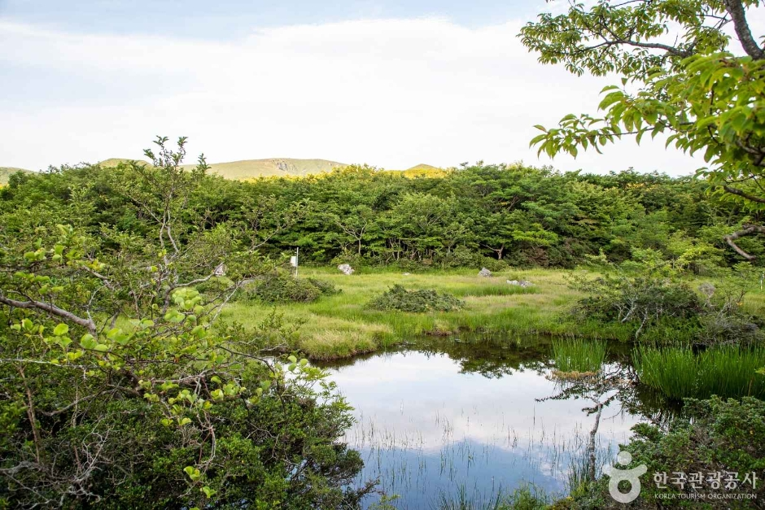
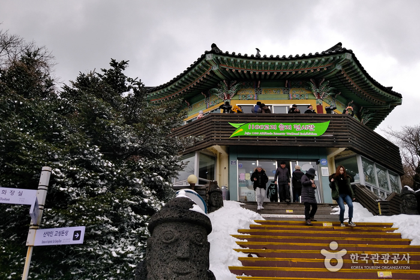
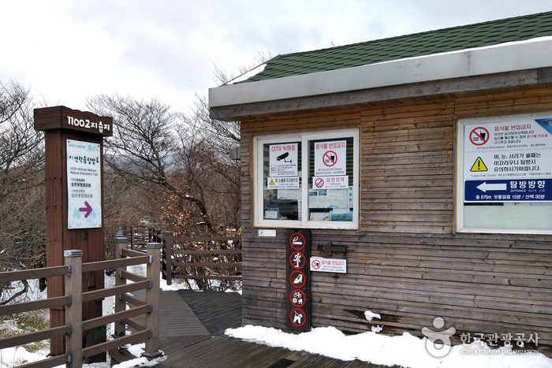

# 1100고지 습지 사진 자료 (2일차 09:30 방문)

## 장소 설명
- 한라산 고원지대에 만들어진 대표적인 산지 습지로, 16개 이상의 습지가 띄엄띄엄 있습니다. 2009년에 습지보호지역으로 지정되고 같은 해 람사르 습지로 등록되었습니다.
- 나무 데크로 된 탐방로가 있어 걸으며 볼 수 있고, 입장료는 무료이며 상시 개방이라고 안내됩니다.
- 주소: 서귀포시 1100로 1555
- 12월 도로 통제와 데크길 정보는 기존 [1100고지습지.md](1100고지습지.md) 참고

## 사진 (한국관광공사 사진 서버의 3장)
사진은 이 폴더의 "사진" 폴더에 내려받아 저장해 두었습니다. 인터넷이 없어도 보입니다. 원래 인터넷 주소는 사진 아래에 "원본 주소"로 남겼습니다.

### 사진 1

- 원본 주소: https://tong.visitkorea.or.kr/cms/resource/07/3314907_image2_1.jpg

### 사진 2

- 원본 주소: https://tong.visitkorea.or.kr/cms/resource/57/2549057_image2_1.jpg

### 사진 3

- 원본 주소: https://tong.visitkorea.or.kr/cms/resource/58/2549058_image2_1.jpg

- 출처 사진 서버: 한국관광공사 (tong.visitkorea.or.kr)
- 사진을 모아 보여 주는 페이지: https://www.ktriptips.com/kor/tourspot/1861656

## 확인 상태와 주의
- 사진 주소 3개는 열어 보니 모두 정상으로 응답했습니다.
- 사진 속 모습은 제가 보지 못했습니다. 사진이 눈 쌓인 겨울 모습인지 여름 모습인지 알 수 없습니다.
- 사진을 보여 주는 사이트가 한국관광공사 공식 사이트인지는 확인하지 못했습니다.
