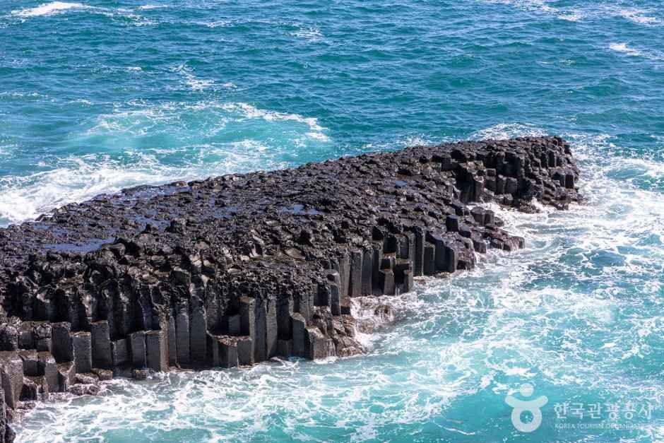
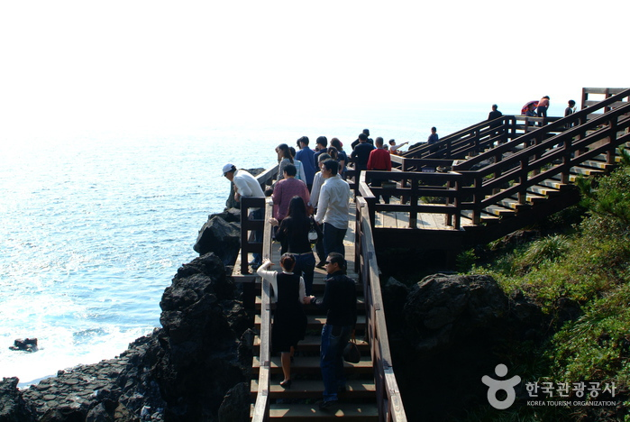
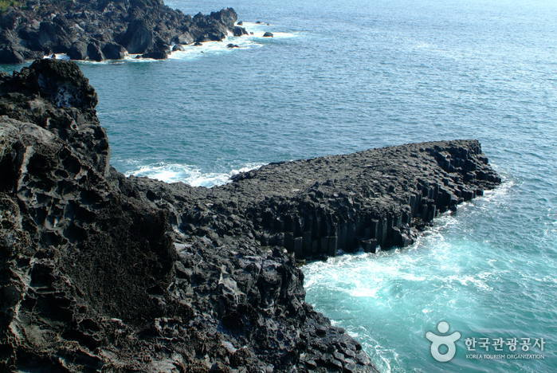

# 대포주상절리대 사진 자료 (2일차 16:00 방문, 중문관광단지)

## 장소 설명
- 중문관광단지 동쪽 해안가에 있는 주상절리대로, 검붉은 육각형 돌기둥이 병풍처럼 둘러서 있고 파도가 부서지는 곳입니다. (한국 여행 정보 사이트의 소개문, 페이지 제목은 "주상절리대(대포동지삿개)")
- 천연기념물 제443호이고, 기둥은 대부분 육각형이며 4각에서 7각까지 다양합니다. 높이가 약 40m에 이르는 기둥도 있습니다. (영문 검색 결과 요약)
- 한 목록에는 운영시간 09:00~17:30, 연중무휴, 성인 입장료 2,000원이라고 나와 있습니다. 공식 확인은 못 했으니 가기 전에 확인이 필요합니다.
- 기존 정보는 [대포주상절리대.md](대포주상절리대.md) 참고

## 사진 (한국관광공사 사진 서버의 3장)
사진은 이 폴더의 "사진" 폴더에 내려받아 저장해 두었습니다. 인터넷이 없어도 보입니다. 원래 인터넷 주소는 사진 아래에 "원본 주소"로 남겼습니다.

### 사진 1

- 원본 주소: https://tong.visitkorea.or.kr/cms/resource/61/3535261_image2_1.jpg

### 사진 2

- 원본 주소: https://tong.visitkorea.or.kr/cms/resource/88/197688_image2_1.jpg

### 사진 3

- 원본 주소: https://tong.visitkorea.or.kr/cms/resource/89/197689_image2_1.jpg

- 출처 사진 서버: 한국관광공사 (tong.visitkorea.or.kr)
- 사진을 모아 보여 주는 페이지: https://www.ktriptips.com/kor/tourspot/127053

## 확인 상태와 주의
- 사진 주소 3개는 열어 보니 모두 정상으로 응답했습니다.
- 사진 속 모습은 제가 보지 못해서 사진별 설명은 적지 않았습니다.
- 사진을 보여 주는 사이트가 한국관광공사 공식 사이트인지는 확인하지 못했습니다.
