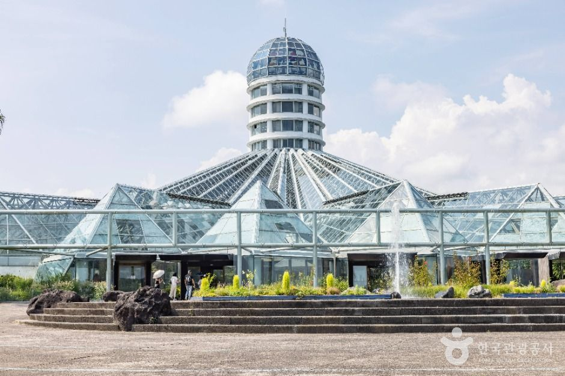
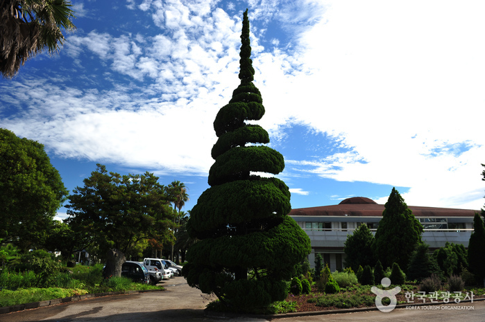
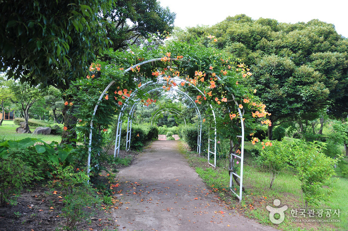

# 여미지식물원 사진 자료 (2일차 대체 코스)

## 장소 설명
- 주소: 제주특별자치도 서귀포시 중문관광로 93 (색달동)
- 공식 사이트 주소로 알려진 곳: https://www.yeomiji.or.kr (검색 결과에 나온 주소, 이번에는 사진을 가져오지 못함)
- 운영시간과 입장료는 기존 [여미지식물원_대체코스.md](여미지식물원_대체코스.md) 참고. 제3자 사이트에는 성인 12,000원, 09:00~18:00이라고 나왔으나 공식 확인은 못 했습니다.

## 사진 (한국관광공사 사진 서버의 3장)
사진은 이 폴더의 "사진" 폴더에 내려받아 저장해 두었습니다. 인터넷이 없어도 보입니다. 원래 인터넷 주소는 사진 아래에 "원본 주소"로 남겼습니다.

### 사진 1

- 원본 주소: https://tong.visitkorea.or.kr/cms/resource/81/3551581_image2_1.jpg

### 사진 2

- 원본 주소: https://tong.visitkorea.or.kr/cms/resource/48/1617148_image2_1.jpg

### 사진 3

- 원본 주소: https://tong.visitkorea.or.kr/cms/resource/49/1617149_image2_1.jpg

- 출처 사진 서버: 한국관광공사 (tong.visitkorea.or.kr)
- 사진을 모아 보여 주는 페이지: https://www.ktriptips.com/kor/tourspot/126464

## 확인 상태와 주의
- 사진 주소 3개는 열어 보니 모두 정상으로 응답했습니다.
- 사진 파일의 이름이 "여미지식물원"이라는 것만 확인했고, 사진 속 모습은 제가 보지 못했습니다. 그래서 사진별 설명은 적지 않았습니다.
- 이 사진을 보여 주는 사이트가 한국관광공사 공식 사이트인지는 확인하지 못했습니다. 사진 파일 자체는 한국관광공사 서버에 있습니다.
- 한라산 길이 막혔을 때 쓰는 대체 코스입니다. 온실이 있는지, 걷는 양이 어느 정도인지는 확인하지 못했습니다.
