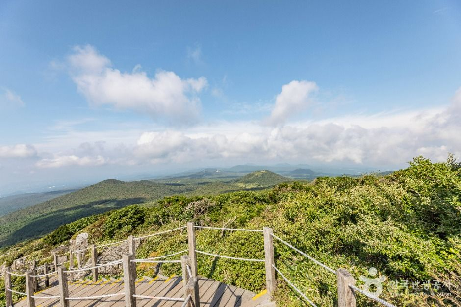
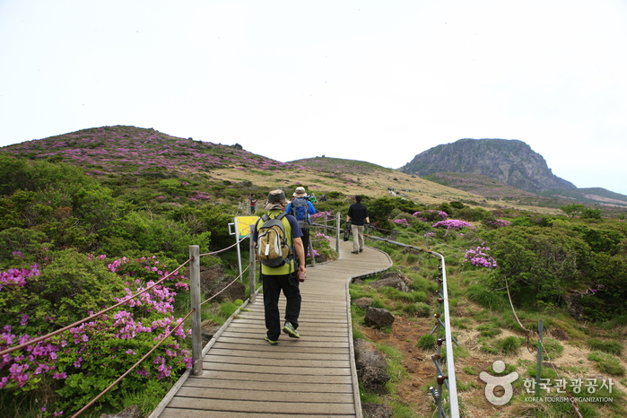
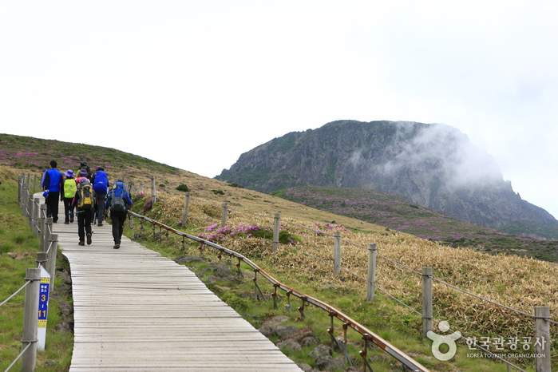

# 영실 (한라산 영실 탐방로 입구와 휴게소 근처) 사진 자료 (2일차 11:00 방문)

## 장소 설명
- 영실 등산로는 길이 5.8km, 2시간 30분이 걸리는 코스로, 한라산 코스 중 가장 짧으면서도 가장 아름다운 구간으로 꼽힌다고 소개됩니다. (한국 여행 정보 사이트 소개문)
- 차로 등산로 앞, 해발 1,280m 고지까지 올라갈 수 있다고 합니다. 일정표의 "차로 갈 수 있는 곳까지만 가기" 계획과 맞습니다.
- 주소: 제주특별자치도 서귀포시 영실로 246
- 문의: 064-747-9950, 주차 가능, 연중무휴, 탐방안내소와 매점 등이 있다고 적혀 있습니다. (사이트 기재)
- 이 사이트에는 "등산 코스별 입산과 하산 시간이 다르니 홈페이지를 참고하라"고만 적혀 있었습니다.

## 12월에 알아 둘 것
- 다른 검색 결과에는 영실 탐방 시간이 10월~3월 05:00~12:00으로 안내된다는 내용이 있었습니다. 출처가 확실하지 않아 확정하지 못했습니다. 이 시간이 맞다면 11:00 방문은 시간이 빠듯하니 한라산국립공원사무소에 확인이 필요합니다.
- 눈이 오면 도로가 통제되거나 체인이 필요할 수 있습니다. [1100고지습지.md](1100고지습지.md) 참고
- 기존 정보는 [영실휴게소_한라산전망.md](영실휴게소_한라산전망.md) 참고

## 사진 (한국관광공사 사진 서버의 3장)
사진은 이 폴더의 "사진" 폴더에 내려받아 저장해 두었습니다. 인터넷이 없어도 보입니다. 원래 인터넷 주소는 사진 아래에 "원본 주소"로 남겼습니다.

### 사진 1

- 원본 주소: https://tong.visitkorea.or.kr/cms/resource/15/3552115_image2_1.jpg

### 사진 2

- 원본 주소: https://tong.visitkorea.or.kr/cms/resource/05/2617905_image2_1.jpg

### 사진 3

- 원본 주소: https://tong.visitkorea.or.kr/cms/resource/06/2617906_image2_1.jpg

- 출처 사진 서버: 한국관광공사 (tong.visitkorea.or.kr)
- 사진을 모아 보여 주는 페이지: https://www.ktriptips.com/kor/tourspot/126469

## 확인 상태와 주의
- 사진 주소 3개는 열어 보니 모두 정상으로 응답했습니다.
- 사진 속 모습은 제가 보지 못했습니다. 영실은 가을 단풍으로 유명해서 사진이 겨울 모습이 아닐 수 있습니다.
- 이 사진 자료는 "영실 탐방로" 페이지의 것이고, 영실 휴게소만 따로 소개한 페이지는 아닙니다.
- 사진을 보여 주는 사이트가 한국관광공사 공식 사이트인지는 확인하지 못했습니다.
