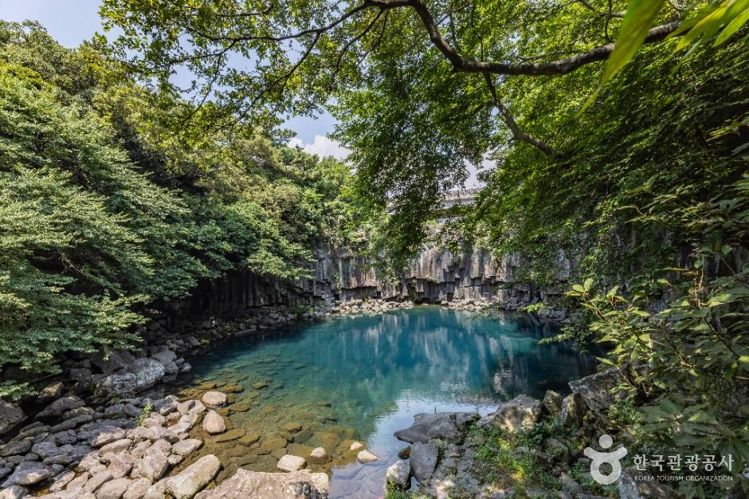
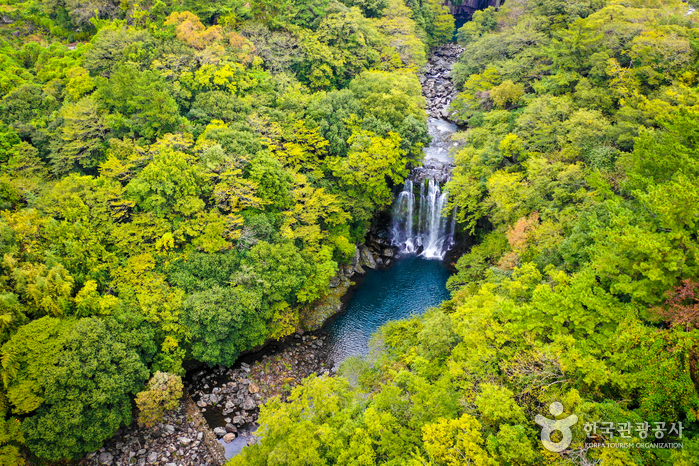
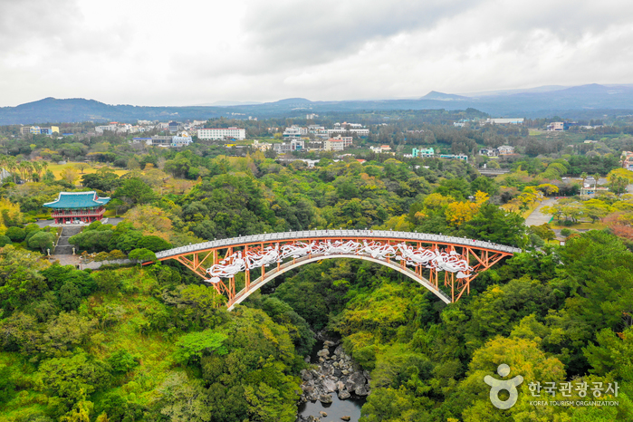

# 천제연폭포 사진 자료 (2일차 14:30 방문, 중문관광단지)

## 장소 설명
- 한라산에서 시작된 중문천이 바다로 흐르면서 만들어진 폭포로, 중문관광단지 안에 있습니다.
- 폭포는 3개로 나뉩니다. 주상절리 절벽에서 천제연(못)으로 떨어지는 것이 제1폭포입니다. (한국 여행 정보 사이트의 소개문)
- 입장료와 운영시간은 기존 [천제연폭포.md](천제연폭포.md) 참고

## 사진 (한국관광공사 사진 서버의 3장)
사진은 이 폴더의 "사진" 폴더에 내려받아 저장해 두었습니다. 인터넷이 없어도 보입니다. 원래 인터넷 주소는 사진 아래에 "원본 주소"로 남겼습니다.

### 사진 1

- 원본 주소: https://tong.visitkorea.or.kr/cms/resource/56/3552156_image2_1.jpg

### 사진 2

- 원본 주소: https://tong.visitkorea.or.kr/cms/resource/02/2650702_image2_1.jpg

### 사진 3

- 원본 주소: https://tong.visitkorea.or.kr/cms/resource/03/2650703_image2_1.jpg

- 출처 사진 서버: 한국관광공사 (tong.visitkorea.or.kr)
- 사진을 모아 보여 주는 페이지: https://www.ktriptips.com/kor/tourspot/126439

## 확인 상태와 주의
- 사진 주소 3개는 열어 보니 모두 정상으로 응답했습니다.
- 사진 파일의 이름이 "천제연폭포"라는 것만 확인했고, 사진 속 모습은 제가 보지 못했습니다. 그래서 사진별 설명은 적지 않았습니다.
- 위 설명문과 사진은 "한국 여행 정보 사이트(KOREA TRIP TIPS)"가 보여 주는 내용입니다. 사진 파일은 한국관광공사 서버에 있지만, 이 사이트가 한국관광공사 공식 사이트인지는 확인하지 못했습니다.
