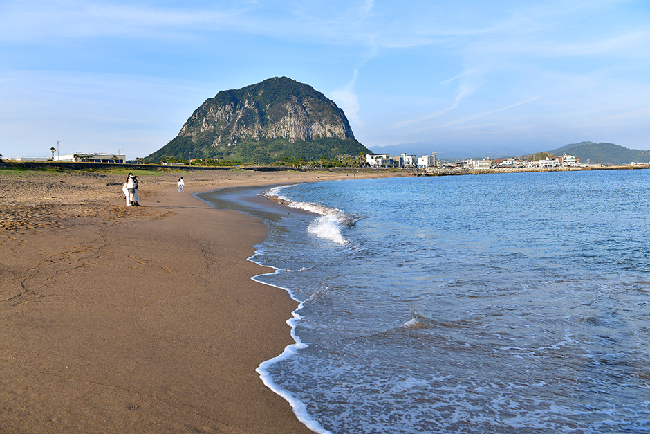
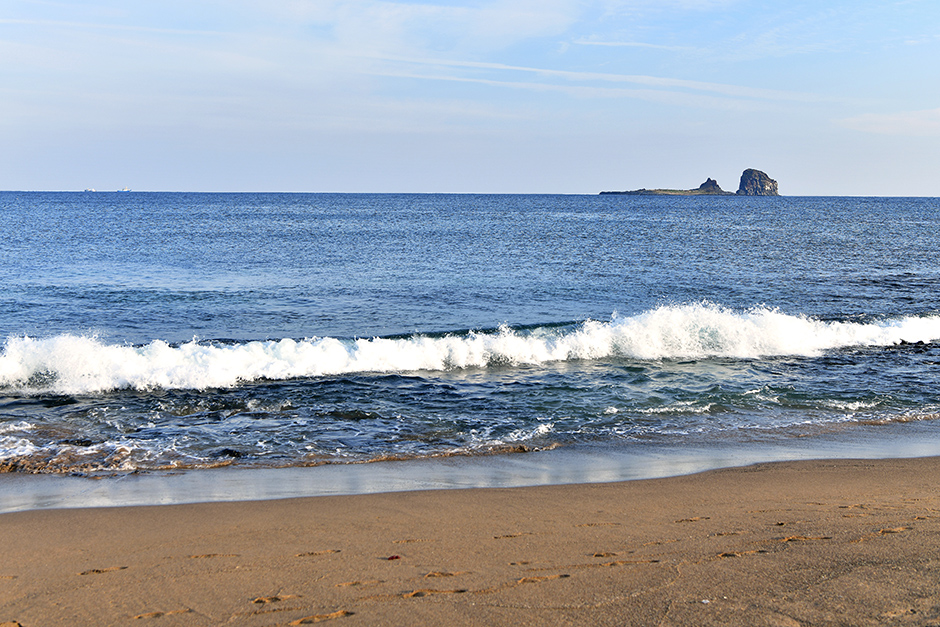
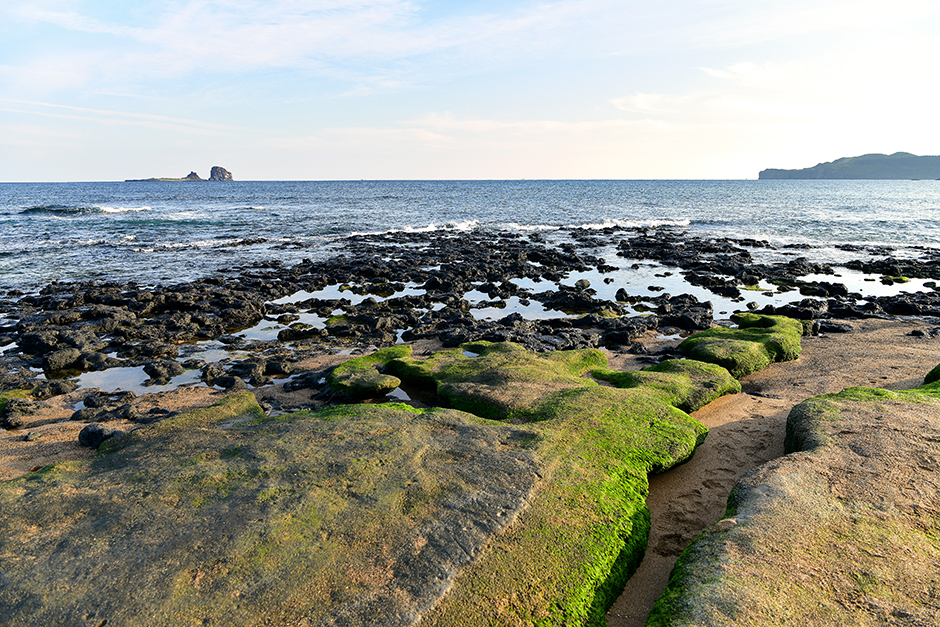

# 사계해안 사진 자료 (3일차 09:40 방문)

## 장소 설명
- 안덕면 사계리 일대 해안도로 옆에 있는 해변으로, 위도로 보면 우리나라에서 가장 남쪽에 있는 해변이라고 소개됩니다. 가파도와 마라도가 보입니다. (한국 여행 정보 사이트의 소개문)
- 산방산 바로 아래쪽에 있는 작고 조용한 해변이며 해수욕은 할 수 없습니다. 올레길 10코스를 따라 걸으면 산방산, 한라산, 용머리해안이 보입니다.
- 사계해안도로는 사계리(산방산)와 대정읍 상모리(송악산) 사이를 잇는 약 10km 길입니다.
- 기존 정보는 [산방산_사계해안.md](산방산_사계해안.md) 참고

## 사진 (한국관광공사 사진 서버의 3장)
사진은 이 폴더의 "사진" 폴더에 내려받아 저장해 두었습니다. 인터넷이 없어도 보입니다. 원래 인터넷 주소는 사진 아래에 "원본 주소"로 남겼습니다.

### 사진 1

- 원본 주소: https://tong.visitkorea.or.kr/cms/resource/59/2800659_image2_1.jpg

### 사진 2

- 원본 주소: https://tong.visitkorea.or.kr/cms/resource/62/2800662_image2_1.jpg

### 사진 3

- 원본 주소: https://tong.visitkorea.or.kr/cms/resource/66/2800666_image2_1.jpg

- 출처 사진 서버: 한국관광공사 (tong.visitkorea.or.kr)
- 사진을 모아 보여 주는 페이지: http://www.koreatriptips.com/tourist-attractions/2791438.html

## 확인 상태와 주의
- 사진 주소 3개는 열어 보니 모두 정상으로 응답했습니다. 페이지에서 사진의 설명 문구(alt)가 "사계해안"으로 되어 있음을 확인했습니다.
- 사진 속 모습은 제가 보지 못했습니다.
- 사진을 보여 주는 사이트가 한국관광공사 공식 사이트인지는 확인하지 못했습니다.
