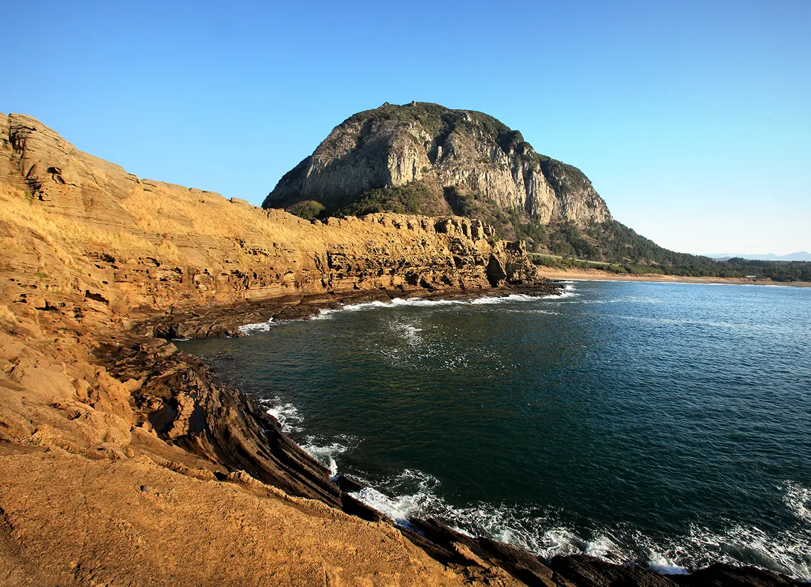
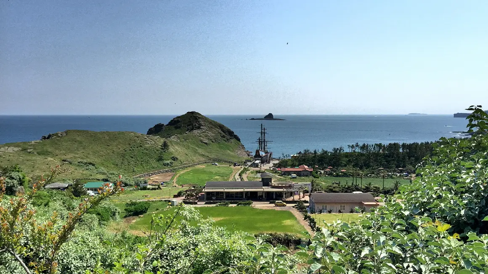
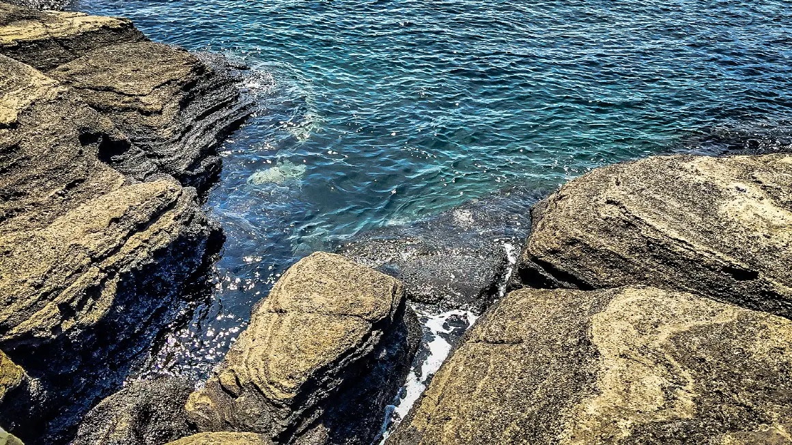

# 산방산 사진 자료 (3일차 09:40 방문)

## 장소 설명
- 제주관광공사 비짓제주: 산방산과 용머리해안을 중심으로 제주 서남부의 화산 지형과 해안 지질을 살펴보는 코스라고 안내합니다. 사계리, 화순리, 덕수리 주변 마을 풍경도 함께 볼 수 있습니다.
- 서귀포시: 산방산은 높이 약 345m이고 조면암질 용암으로 이루어진 종 모양의 화산체입니다. 산방굴과 암벽식물지대가 있습니다.
- 기존 정보는 [산방산_사계해안.md](산방산_사계해안.md) 참고

## 사진 (제주관광공사 공식 페이지의 3장)
사진은 이 폴더의 "사진" 폴더에 내려받아 저장해 두었습니다. 인터넷이 없어도 보입니다. 원래 인터넷 주소는 사진 아래에 "원본 주소"로 남겼습니다.

### 사진 1

- 원본 주소: https://api.cdn.visitjeju.net/photomng/imgpath/201804/30/59a6c172-6ee6-4c97-bb94-d762a203a321.webp
- 설명: 용머리해안과 그 뒤로 보이는 산방산
- 출처: 제주관광공사 비짓제주 https://www.visitjeju.net/kr/detail/view?contentsid=CNTS_000000000021380

### 사진 2

- 원본 주소: https://api.cdn.visitjeju.net/photomng/imgpath/202111/09/d55a72da-f1c1-4e2c-99bb-c3023ce99e3a.webp
- 설명: 산방산 일대를 내려다본 전경
- 출처: 제주관광공사 비짓제주 https://www.visitjeju.net/kr/detail/view?contentsid=CNTS_000000000021380

### 사진 3

- 원본 주소: https://api.cdn.visitjeju.net/photomng/imgpath/202111/09/9dfeac40-fefe-4ef1-ae9f-5dff1bfc78d0.webp
- 설명: 층층이 쌓인 해안 암석과 바닷물
- 출처: 제주관광공사 비짓제주 https://www.visitjeju.net/kr/detail/view?contentsid=CNTS_000000000021380

## 참고 링크
- 서귀포시 E-Ticket 산방산 안내: https://eticket.seogwipo.go.kr/contents?bmcode=sanbangsan

## 확인 상태와 주의
- 사진 주소는 열어 보니 모두 정상으로 응답했습니다.
- 사진 설명은 공식 페이지의 사진 설명 문구(alt)를 근거로 적었고, 제가 사진을 직접 보지는 못했습니다.
- 비짓제주 페이지는 "산방산 용머리해안 지질트레일" 코스 안내 페이지입니다. 산방산 하나만 소개하는 공식 페이지는 찾지 못했습니다.
- 용머리해안은 일정표에 없는 곳입니다. 사진 속 용머리해안 풍경은 참고용입니다.
- 사계해안은 공식 사진을 찾지 못했습니다.
