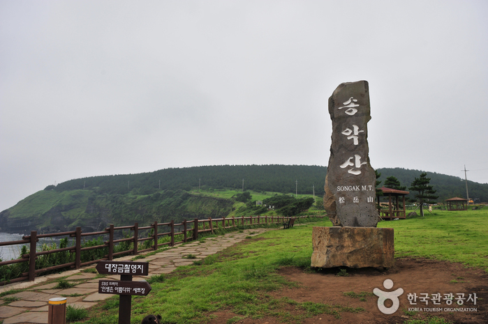
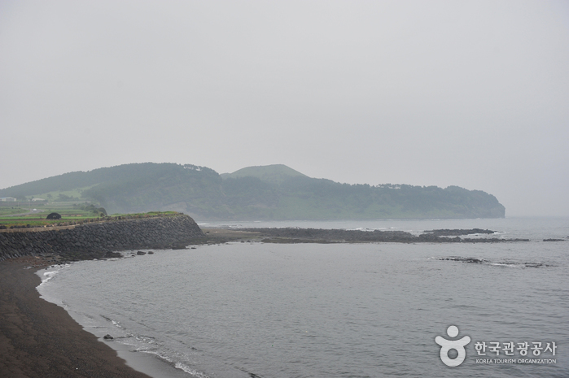
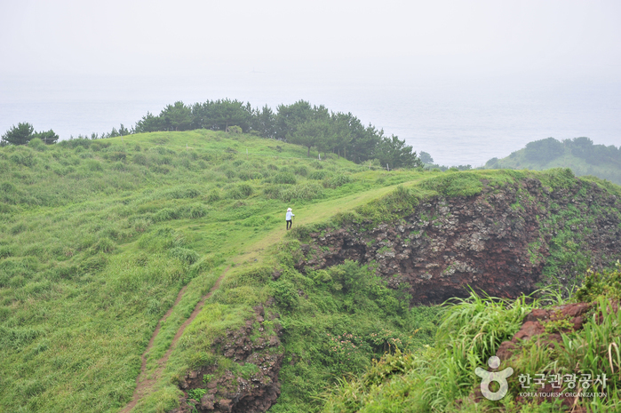

# 송악산 사진 자료 (3일차 10:40 방문)

## 장소 설명
- 바닷속 화산 활동으로 만들어진 산으로, 두 개의 화산 분화구가 있어 지질학적 가치가 큽니다. (한국 여행 정보 사이트 영문 소개문)
- 정상(전망대)에서는 가까이 마라도, 가파도, 형제섬이 보이고, 멀리 산방산과 한라산이 보입니다.
- 송악산 둘레길은 약 2.8km이고, 경사가 완만해서 가족이 걷기 쉽다고 소개됩니다. 바람이 많이 불 수 있습니다.
- 입장료 무료, 화장실 있음 (사이트 기재). 주소는 서귀포시 대정읍 상모리 일대입니다.
- 일정표 원칙은 둘레길 전체를 걷지 않고 전망 지점까지만 가는 것입니다.
- 기존 정보는 [송악산.md](송악산.md) 참고

## 사진 (한국관광공사 사진 서버의 3장)
사진은 이 폴더의 "사진" 폴더에 내려받아 저장해 두었습니다. 인터넷이 없어도 보입니다. 원래 인터넷 주소는 사진 아래에 "원본 주소"로 남겼습니다.

### 사진 1

- 원본 주소: https://tong.visitkorea.or.kr/cms/resource/30/1620230_image2_1.jpg

### 사진 2

- 원본 주소: https://tong.visitkorea.or.kr/cms/resource/29/1620229_image2_1.jpg

### 사진 3

- 원본 주소: https://tong.visitkorea.or.kr/cms/resource/31/1620231_image2_1.jpg

- 출처 사진 서버: 한국관광공사 (tong.visitkorea.or.kr)
- 사진을 모아 보여 주는 페이지: https://www.ktriptips.com/kor/tourspot/1768982

## 확인 상태와 주의
- 사진 주소 3개는 열어 보니 모두 정상으로 응답했습니다.
- 사진 속 모습은 제가 보지 못해서 사진별 설명은 적지 않았습니다.
- 이 사이트의 송악산 소개 페이지는 영어 페이지입니다. 설명은 제가 한국어로 옮겨 적었습니다.
- 사진을 보여 주는 사이트가 한국관광공사 공식 사이트인지는 확인하지 못했습니다.
