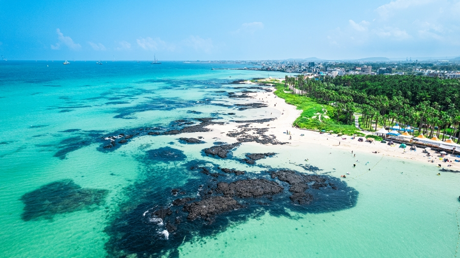
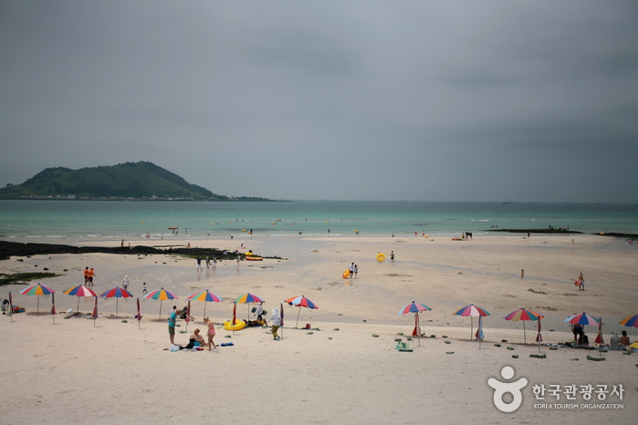
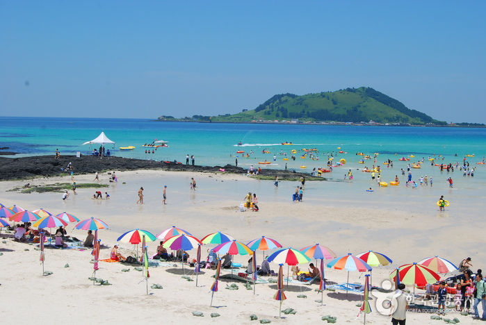

# 협재해변 사진 자료 (3일차 14:00 방문)

## 장소 설명
- 협재해수욕장은 제주시 서쪽 한림공원 가까이에 있습니다. 조개껍질 가루가 많이 섞인 백사장, 앞바다에 떠 있는 비양도, 코발트빛 바다와 소나무 숲이 어우러진 곳입니다. (한국 여행 정보 사이트의 소개문)
- 수심이 얕고 경사가 완만해서 가족이 가기에 알맞다고 소개되고, 탈의실, 샤워실, 휴게소, 식수대, 화장실이 있습니다.
- 주소: 제주시 한림읍 한림로 329-10, 문의 064-728-3981
- 상시 개방, 연중무휴, 주차 가능 (사이트 기재, 주차비는 확인하지 못함)
- 남서쪽으로 금능해수욕장과 이어져 있어 두 해변을 합쳐 부르기도 합니다.
- 기존 정보는 [협재해변.md](협재해변.md) 참고

## 사진 (한국관광공사 사진 서버의 3장)
사진은 이 폴더의 "사진" 폴더에 내려받아 저장해 두었습니다. 인터넷이 없어도 보입니다. 원래 인터넷 주소는 사진 아래에 "원본 주소"로 남겼습니다.

### 사진 1

- 원본 주소: https://tong.visitkorea.or.kr/cms/resource/66/3096066_image2_1.jpg

### 사진 2

- 원본 주소: https://tong.visitkorea.or.kr/cms/resource/26/217426_image2_1.jpg

### 사진 3

- 원본 주소: https://tong.visitkorea.or.kr/cms/resource/73/218873_image2_1.jpg

- 출처 사진 서버: 한국관광공사 (tong.visitkorea.or.kr)
- 사진을 모아 보여 주는 페이지: https://www.ktriptips.com/kor/tourspot/127490

## 확인 상태와 주의
- 사진 주소 3개는 열어 보니 모두 정상으로 응답했습니다.
- 사진 속 모습은 제가 보지 못했습니다. 여름 해수욕 사진일 수 있어서, 12월 모습과 다를 수 있습니다.
- 사진을 보여 주는 사이트가 한국관광공사 공식 사이트인지는 확인하지 못했습니다.
