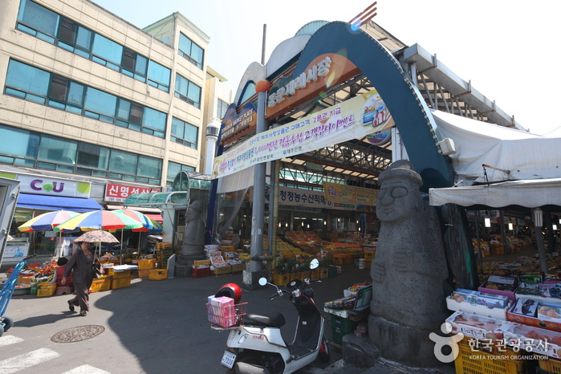
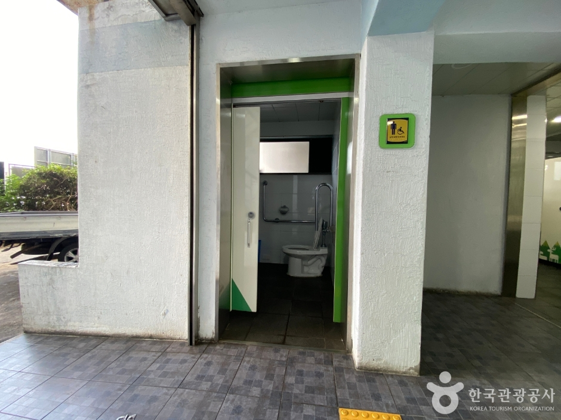
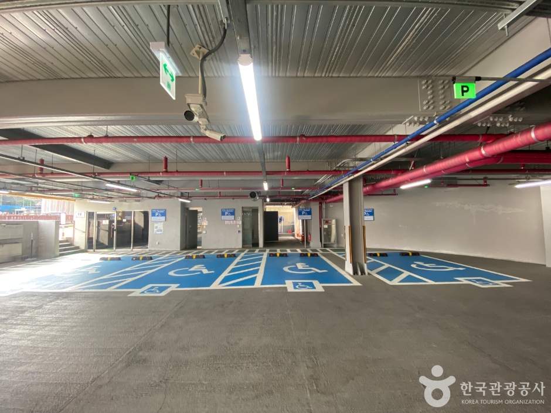

# 동문시장 (동문재래시장) 사진 자료 (4일차 15:00 방문, 제주시)

## 장소 설명
- 제주시의 대표적인 전통 재래시장입니다. 1945년 광복 직후 생겼고, 1954년 큰 불이 난 뒤 지금 자리로 옮겼습니다. (한국 여행 정보 사이트 소개문)
- 야채, 과일, 수산물, 약초, 곡물, 옷 등을 팔고, 신선한 해산물이 특히 인기입니다. 상가는 약 300곳입니다.
- 영업시간: 08:00~21:00 (사이트 기재)
- 주소: 제주시 관덕로14길 20
- 옆의 동문수산시장과 함께 제주에서 가장 큰 상설 시장을 이룹니다.
- 기존 정보는 [동문시장.md](동문시장.md) 참고

## 사진 (한국관광공사 사진 서버의 3장)
사진은 이 폴더의 "사진" 폴더에 내려받아 저장해 두었습니다. 인터넷이 없어도 보입니다. 원래 인터넷 주소는 사진 아래에 "원본 주소"로 남겼습니다.

### 사진 1

- 원본 주소: https://tong.visitkorea.or.kr/cms/resource/38/2678438_image2_1.jpg

### 사진 2

- 원본 주소: https://tong.visitkorea.or.kr/cms/resource/86/3039486_image2_1.jpeg

### 사진 3

- 원본 주소: https://tong.visitkorea.or.kr/cms/resource/88/3039488_image2_1.jpeg

- 출처 사진 서버: 한국관광공사 (tong.visitkorea.or.kr)
- 사진을 모아 보여 주는 페이지: https://www.ktriptips.com/kor/shopping/1018338

## 확인 상태와 주의
- 사진 주소 3개는 열어 보니 모두 정상으로 응답했습니다.
- 사진 속 모습은 제가 보지 못해서 사진별 설명은 적지 않았습니다.
- 사진을 보여 주는 사이트가 한국관광공사 공식 사이트인지는 확인하지 못했습니다.
- 시장 운영시간은 이 사이트 기재 내용이라 방문 전 확인이 필요합니다.
