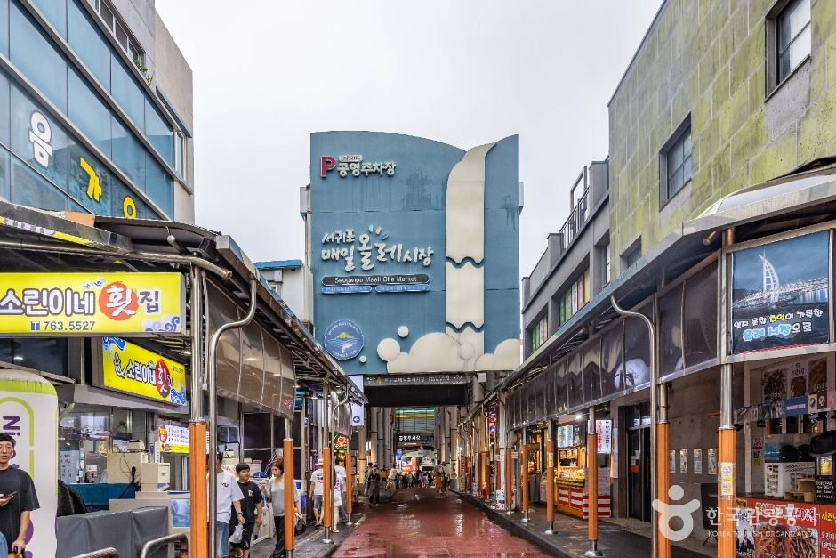
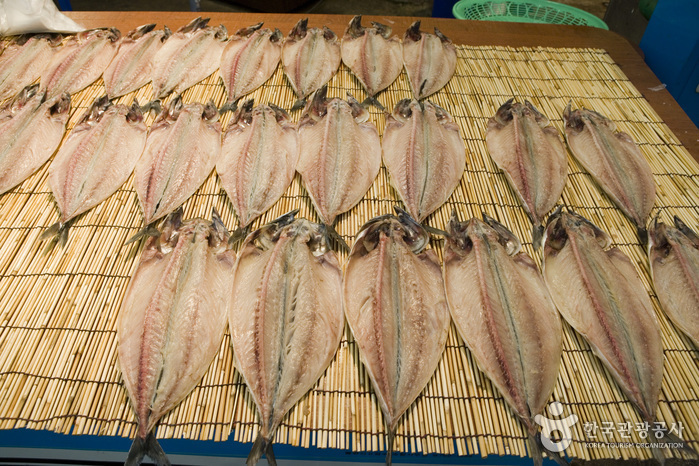
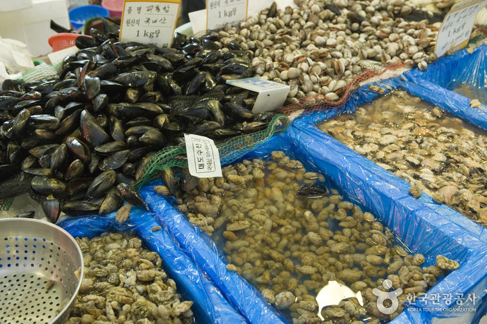

# 서귀포 매일올레시장 사진 자료 (4일차 11:00 방문)

## 장소 설명
- 서귀포에서 가장 큰 시장입니다. 1960년대 초에 생겼고, 2001년부터 상가가 넓어져서 길이가 620m가 넘습니다. (한국 여행 정보 사이트 영문 소개문)
- 농산물, 수산물, 생활용품을 많이 팔고 연중무휴입니다.
- 영업시간: 여름 07:00~21:00, 겨울 07:00~20:00 (사이트 기재)
- 주소: 서귀포시 중앙로62번길 18
- 서귀포시 전통시장 목록(2026.8 기준)에서는 소재지 서귀동 277-1, 점포 수 237개, 개장일 "매일"로 확인했습니다. 이 목록에는 운영시간이 없었습니다.
- 기존 정보는 [서귀포매일올레시장.md](서귀포매일올레시장.md) 참고

## 사진 (한국관광공사 사진 서버의 3장)
사진은 이 폴더의 "사진" 폴더에 내려받아 저장해 두었습니다. 인터넷이 없어도 보입니다. 원래 인터넷 주소는 사진 아래에 "원본 주소"로 남겼습니다.

### 사진 1

- 원본 주소: https://tong.visitkorea.or.kr/cms/resource/66/3546866_image2_1.jpg

### 사진 2

- 원본 주소: https://tong.visitkorea.or.kr/cms/resource/42/1020942_image2_1.jpg

### 사진 3

- 원본 주소: https://tong.visitkorea.or.kr/cms/resource/51/1020951_image2_1.jpg

- 출처 사진 서버: 한국관광공사 (tong.visitkorea.or.kr)
- 사진을 모아 보여 주는 페이지: https://www.ktriptips.com/kor/shopping/1023956

## 확인 상태와 주의
- 사진 주소 3개는 열어 보니 모두 정상으로 응답했습니다.
- 사진 속 모습은 제가 보지 못했습니다. 일부 사진은 오래된 것일 수 있습니다.
- 사진을 보여 주는 사이트가 한국관광공사 공식 사이트인지는 확인하지 못했습니다.
- 시장 운영시간은 이 사이트 기재 내용이라 방문 전 확인이 필요합니다.
