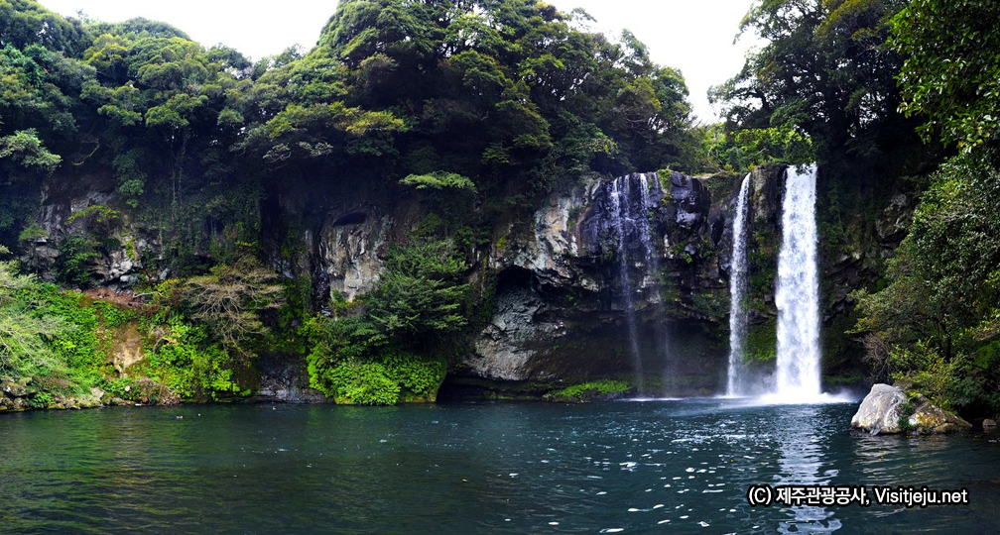

# 천지연폭포 사진 자료 (4일차 09:30 방문)

## 장소 설명
- 서귀포시 공식 안내: 기암절벽 위에서 쏟아져 내리는 하얀 물기둥이 천지연폭포이며, 높이 22m, 폭 12m입니다.
- 계곡에는 천연기념물 제163호 담팔수나무와 난대성 식물이 자라고, 천연기념물 제27호 무태장어가 삽니다.
- 관람시간: 09:00~22:00 (입장마감 21:20), 이용 문의 064-733-1528 (공식 페이지 기재)
- 기존 정보는 [천지연폭포.md](천지연폭포.md) 참고

## 사진 (공식 출처에서 확인한 1장)
사진은 이 폴더의 "사진" 폴더에 내려받아 저장해 두었습니다. 인터넷이 없어도 보입니다. 원래 인터넷 주소는 사진 아래에 "원본 주소"로 남겼습니다.

### 사진 1

- 원본 주소: https://eticket.seogwipo.go.kr/img/tour-large1.jpg
- 설명: 서귀포시 공식 페이지 "포토갤러리"에 실린 유일한 사진 (설명 문구가 없어 사진 속 모습은 확인하지 못함)
- 출처: 서귀포시 E-Ticket https://eticket.seogwipo.go.kr/contents?bmcode=cheonjiyeon

## 확인 상태와 주의
- 사진과 페이지 주소는 열어 보니 모두 정상으로 응답했습니다.
- 사진은 1장만 찾았습니다. 최대 3장까지 넣기로 했지만 공식 출처에서 더 찾지 못했습니다.
- 앞서 정리한 운영시간 중 "09:00~22:00 (입장마감 21:20)"이 공식 페이지에서 확인되었습니다. 17:50이라는 오래된 목록은 공식 정보와 다릅니다.
